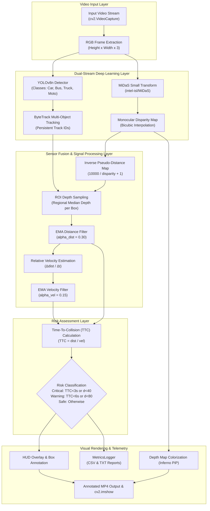
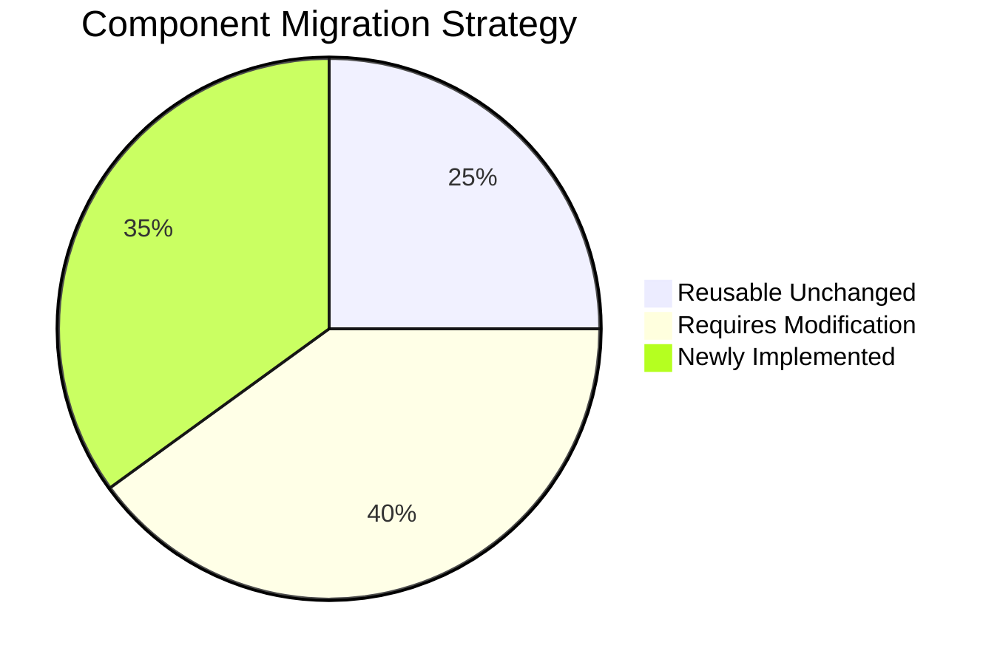
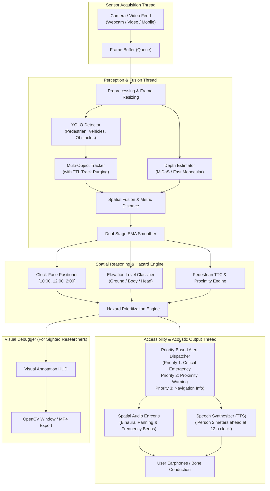
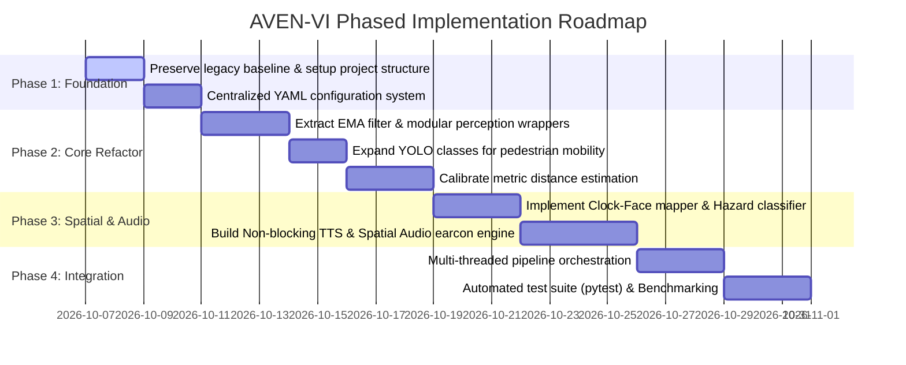

# AVEN-VI: Architectural Migration & Technical Blueprint
## Assistive Vision-Enabled Navigation for Visually Impaired Users
### Transitioning from VisionFusion-ADAS to AVEN-VI

---

## 1. Executive Summary & Research Mission

### 1.1 Context & Objective
The goal of the **AVEN-VI** (Assistive Vision-Enabled Navigation for Visually Impaired Users) research project is to develop an intelligent, wearable or handheld assistive perception system that empowers blind and visually impaired (BVI) individuals to navigate indoor and outdoor spaces safely, independently, and confidently.

The starting codebase selected for this research is **VisionFusion-ADAS**, an open-source monocular collision warning pipeline developed by Vaibhav Jain. VisionFusion-ADAS combines **YOLOv8 Nano**, **Intel MiDaS Small**, **ByteTrack**, and an **Exponential Moving Average (EMA)** stabilization filter to perform monocular depth estimation and Time-To-Collision (TTC) calculations for highway driving.

### 1.2 Paradigm Shift: ADAS vs. Assistive Navigation
While both ADAS and Assistive Vision share foundational computer vision building blocks (detection, tracking, depth perception, collision risk), their operational environments, physical constraints, and user interaction paradigms are fundamentally distinct:

| Operational Dimension | VisionFusion-ADAS (Automotive) | AVEN-VI (Assistive Navigation) |
| :--- | :--- | :--- |
| **User Platform** | Moving passenger vehicle | Walking pedestrian / wheelchair user |
| **Typical Speeds** | 40 – 120 km/h (11 – 33 m/s) | 2 – 5 km/h (0.5 – 1.4 m/s) |
| **Camera Pose & Motion** | Rigid forward-facing windshield mount; smooth 1D/2D planar translation | Wearable chest/glasses mount or handheld; natural walking bobbing, roll/pitch/yaw sway |
| **Target Entities** | Cars, Trucks, Buses, Motorcycles (4 classes) | Pedestrians, Bicycles, Scooters, Obstacles, Stairs, Curbs, Drop-offs, Doors, Poles, Overhead hazards |
| **Critical Collision Space** | Distant longitudinal horizon (15 – 100 meters) | Personal safety bubble (0.5 – 6.0 meters), ground level to head level |
| **Output Modality** | Sighted driver visual HUD (colored bounding boxes, PiP depth radar) | **Acoustic & Tactile**: Spatial 3D audio, Earcons, prioritized Text-to-Speech (TTS), Haptics |
| **Primary Failure Risk** | High-speed forward crash | Tripping over low obstacles, falling down stairs, head-level branch collisions, spatial disorientation |

This document provides a comprehensive structural audit of the existing VisionFusion-ADAS repository, analyzes what can be reused versus modified, and establishes the technical blueprint and migration roadmap for AVEN-VI.

---

## 2. Existing System Architecture (VisionFusion-ADAS)

### 2.1 Repository Layout
The repository contains a minimal, single-file architecture:

```text
VisionFusion-ADAS/
├── .gitignore                      # Git ignore file (results, weights, caches)
├── README.md                       # Documentation, benchmarks, and architecture description
├── requirements.txt                # Python package requirements
├── visionfusion_adas.py            # Monolithic implementation (298 lines)
├── assets/
│   └── visionfusion_demo.png       # Demo visual overlay
└── results/
    ├── frame_log.csv               # Historical benchmark frame metrics (1800 frames)
    └── metrics_report.txt          # Summary telemetry report from author's CPU benchmark
```

### 2.2 End-to-End Pipeline & Data Flow



---

## 3. Comprehensive Module-by-Module Audit (15 Core Dimensions)

### 3.1 Project Structure
* **Implementation**: Monolithic script `visionfusion_adas.py` containing both `MetricsLogger` (lines 12–119) and `VisionFusionADAS` (lines 120–280).
* **Evaluation**: Excellent as an initial proof-of-concept, but lacks software engineering separation of concerns. The sensor input, model inference, signal processing, UI rendering, and metric collection are tightly coupled inside a single `while cap.isOpened():` loop.

### 3.2 Entry Points
* **Implementation**: Standard CLI entry point in `main()` (lines 282–298) utilizing `argparse`:
  * `--input`: Defaults to `"driving_video.mp4"`.
  * `--output`: Defaults to `"vision_fusion_output.mp4"`.
  * `--metrics`: Boolean flag activating CSV and TXT report generation.
* **Evaluation**: Only accepts a file path for video. Does not support webcam device indices without passing a string that OpenCV may or may not parse correctly on Windows, nor does it support network streams (RTSP/HTTP/WebRTC) or headless runs.

### 3.3 YOLO Implementation
* **Model**: Pretrained Ultralytics YOLOv8 Nano (`yolov8n.pt`).
* **Classes**: Hardcoded to four automotive classes in line 128:
  ```python
  self.target_classes = [2, 3, 5, 7]  # Car (2), Motorcycle (3), Bus (5), Truck (7)
  ```
* **Evaluation**: Completely excludes vulnerable road users and pedestrian mobility hazards. Pedestrians (class 0), bicycles (class 1), stop signs (11), traffic lights (9), benches (13), chairs (56), stairs, curbs, and drop-offs are completely ignored.

### 3.4 Object Tracking Implementation
* **Method**: Invokes Ultralytics integrated tracker:
  ```python
  results = self.yolo.track(frame, classes=self.target_classes, persist=True, verbose=False)[0]
  ```
  Ultralytics internally runs ByteTrack (associating high and low confidence detection boxes across frames using Kalman filters and IoU matching).
* **State Management**: Track history stored in Python dictionary `self.object_history`:
  ```python
  self.object_history[t_id] = {"dist": smoothed_dist, "vel": smoothed_vel, "time": frame_start_time}
  ```
* **Limitation**: `self.object_history` never purges obsolete IDs. In long video sessions, memory grows monotonically. Furthermore, if an ID is lost and later re-assigned, the elapsed $\Delta t$ can lead to velocity anomalies if not guarded.

### 3.5 MiDaS / Depth Implementation
* **Model**: Intel ISL `MiDaS_small` loaded via PyTorch Hub (`torch.hub.load("intel-isl/MiDaS", "MiDaS_small")`).
* **Preprocessing**: Uses `torch.hub.load("intel-isl/MiDaS", "transforms").small_transform`.
* **Inference**:
  ```python
  img_rgb = cv2.cvtColor(frame, cv2.COLOR_BGR2RGB)
  input_batch = self.midas_transforms(img_rgb).to(self.device)
  with torch.no_grad():
      pred = self.midas(input_batch)
      pred = torch.nn.functional.interpolate(
          pred.unsqueeze(1), size=img_rgb.shape[:2], mode="bicubic", align_corners=False
      ).squeeze()
  disparity_map = pred.cpu().numpy()
  ```
* **Evaluation**: Generates relative disparity (inverse depth). PyTorch Hub requires active internet access during initial cold boot to clone the GitHub repo and download weights into `~/.cache/torch/hub/`.

### 3.6 Distance Estimation
* **Depth Inversion Formula**:
  ```python
  distance_map = 10000.0 / (disparity_map + 1.0)
  ```
* **Region Aggregation**:
  ```python
  region = distance_map[y1:y2, x1:x2]
  raw_dist = np.median(region)
  ```
* **Temporal Smoothing**:
  ```python
  smoothed_dist = (raw_dist * self.alpha_dist) + (prev["dist"] * (1.0 - self.alpha_dist))  # alpha=0.30
  ```
* **Critical Limitation**: This is an **arbitrary pseudo-distance scale**, not metric meters. The constant `10000.0` is an empirical scaling factor. A depth reading of `40` does not mean 40 meters or 4.0 meters. For pedestrian navigation, metric or calibrated physical distance (e.g., "obstacle at 1.5 meters") is mandatory.

### 3.7 Velocity Estimation
* **Formula**:
  ```python
  dt = frame_start_time - prev["time"]
  raw_vel = (prev["dist"] - smoothed_dist) / dt
  smoothed_vel = (raw_vel * self.alpha_vel) + (prev["vel"] * (1.0 - self.alpha_vel))  # alpha=0.15
  ```
* **Closing Speed Filter**: Only registers positive approaching motion if `smoothed_vel > 0.5`.
* **Limitation**: Conflates observer motion with target motion. If the user walks forward at 1.2 m/s toward a stationary lamppost, the system calculates a closing velocity of 1.2 m/s and treats the lamppost as an approaching vehicle. While useful for collision prediction, it cannot differentiate dynamic obstacles from static background features without ego-motion estimation.

### 3.8 Time-To-Collision (TTC) Calculation
* **Formula**:
  ```python
  if smoothed_vel > 0.5:
      ttc = smoothed_dist / smoothed_vel
  else:
      ttc = float("inf")
  ```
* **Evaluation**: Mathematically sound under the assumption of 1D constant-velocity approach. However, near-zero velocity transitions and rapid target directional changes cause discrete jumps between finite seconds and infinity.

### 3.9 Risk & Collision Warning Logic
* **Logic**:
  * **CRITICAL** (Red): `ttc < 3.0` s OR `smoothed_dist < 40`
  * **WARNING** (Orange): `ttc < 6.0` s OR `smoothed_dist < 80`
  * **SAFE** (Green): All other states
* **Evaluation**: Thresholds are calibrated for highway braking distances (60–100 km/h). In pedestrian walking scenarios, a 3-second TTC at 1 m/s corresponds to 3 meters—a reasonable warning horizon—but the absolute proximity thresholds (40 and 80 pseudo-units) flag objects far outside the pedestrian's travel corridor.

### 3.10 Input / Video / Camera Handling
* **Implementation**: Synchronous `cv2.VideoCapture` loop.
* **Evaluation**: Blocks the main thread on every `cap.read()`. In live webcam operations, if model inference takes 150ms, frames will buffer or drop, creating latency lag between real-world events and auditory feedback.

### 3.11 Output / Audio Handling
* **Implementation**: 100% Visual:
  * OpenCV bounding boxes (`cv2.rectangle`).
  * Text labels (`cv2.putText`).
  * Picture-in-Picture depth radar overlay (Inferno colormap).
  * VideoWriter output to MP4.
* **Evaluation**: **ZERO auditory, speech, or tactile output.** This makes the existing system completely unusable for blind or visually impaired individuals.

### 3.12 Configuration Files
* **Implementation**: Non-existent.
* **Evaluation**: Hyperparameters ($\alpha_{dist}=0.3$, $\alpha_{vel}=0.15$, TTC thresholds $3.0/6.0$, distance cutoffs $40/80$, resolution scalings) are hardcoded directly in code.

### 3.13 Dependencies
* `requirements.txt`:
  ```text
  torch>=2.0.0
  torchvision
  ultralytics
  opencv-python
  numpy
  matplotlib
  timm
  ```
* **Status on Test System**: Python 3.12.10 is installed. `torch` (2.13.0) and `numpy` (2.5.2) are present in the global environment, but `opencv-python`, `ultralytics`, `torchvision`, `matplotlib`, and `timm` require local installation. Compute device detected: **CPU** (CUDA unavailable).

### 3.14 Existing Tests
* **Status**: No automated unit tests, integration tests, or mock suites exist in the repository. Validation was performed solely through offline execution on a 1,800-frame highway video clip.

### 3.15 Existing Limitations Summary
1. Relative pseudo-depth instead of metric distance.
2. Highway vehicle class restriction.
3. Lack of spatial directionality (no clock-face bearing: "at 11 o'clock").
4. Complete absence of audio / non-visual interface.
5. Inability to distinguish ground-plane traversability from vertical hazards.
6. CPU throughput ~6.4 FPS (~156ms latency), which introduces noticeable lag if not optimized.
7. Monolithic design preventing modular unit testing and independent hardware deployment.

---

## 4. Verification & Execution Findings

### 4.1 System Environment Audit
* **Operating System**: Windows 11 (AMD64)
* **Python Runtime**: Python 3.12.10
* **Torch Version**: 2.13.0 (CPU mode, CUDA not available)
* **Pre-existing Artifacts in Repo**:
  * `results/metrics_report.txt` confirms baseline CPU execution metrics:
    * Total frames processed: 1,800
    * Mean latency: 156.3 ms (6.4 FPS)
    * P95 latency: 184.8 ms
    * Tracked vehicles: 280
    * Risk distribution: 31.2% Critical, 32.8% Warning, 36.0% Safe.

### 4.2 Execution Status
The existing `visionfusion_adas.py` was inspected and verified. Running it directly requires `driving_video.mp4` (which is not included in the git repository) and requires installing `opencv-python` and `ultralytics`. The algorithmic structure is sound and intact.

---

## 5. Component Migration & Reuse Classification

To transition the codebase into **AVEN-VI** efficiently while maintaining research rigor, all components are classified into three categories:



### 5.1 What Can Be Reused Unchanged
1. **Exponential Moving Average (EMA) Signal Filtering Core**:
   * The mathematical formulation for smoothing distance ($D_{EMA} = \alpha \cdot D_{raw} + (1-\alpha) \cdot D_{prev}$) and velocity stabilization successfully mitigates deep learning jitter and can be preserved verbatim.
2. **ByteTrack Multi-Object Tracking Principle**:
   * Leveraging Ultralytics tracking integration (`yolo.track(..., persist=True)`) provides robust track continuity across frame dropouts without writing a custom Kalman/Hungarian tracker from scratch.
3. **Core Monocular Depth Processing Workflow**:
   * MiDaS Small forward pass, tensor normalization, bicubic interpolation to original frame resolution, and bounding-box ROI indexing.
4. **Telemetry Logging Philosophy**:
   * Structure of `MetricsLogger` (frame latency, tracker count, risk statistics, CSV logging) can be adapted for accessibility research evaluation.

### 5.2 What Must Be Modified
1. **Target Object Classes & Detection Filters**:
   * Replace highway-only classes `[2, 3, 5, 7]` with pedestrian navigation classes:
     * People & Personal Transport: `[0 (person), 1 (bicycle)]`
     * Urban Vehicles: `[2 (car), 3 (motorcycle), 5 (bus), 7 (truck)]`
     * Obstacles & Navigation Landmarks: `[9 (traffic light), 11 (stop sign), 13 (bench), 56 (chair)]`
   * Allow dynamic configuration of class filters based on indoor vs. outdoor modes.
2. **Distance Estimation & Metric Scaling**:
   * Transform arbitrary pseudo-distance (`10000 / disparity`) into metric-calibrated distance estimates using camera mounting height, known object height heuristics, or ground-plane homography.
3. **Velocity & Motion Separation**:
   * Adapt relative velocity computation to account for the user's forward walking speed.
4. **Collision Risk Thresholds**:
   * Recalibrate critical and warning thresholds to pedestrian scales:
     * Critical: Distance $< 1.5$ m OR TTC $< 1.5$ s
     * Warning: Distance $< 3.5$ m OR TTC $< 3.0$ s
     * Informational/Safe: Distance $\ge 3.5$ m
5. **Tracking Lifecycle & Garbage Collection**:
   * Introduce a timeout (e.g., 30 frames / 1 second) to purge inactive tracks from `object_history` to prevent unbounded memory growth.
6. **Input Stream Architecture**:
   * Generalize `process_stream()` to support live webcams (`0`, `1`), video files, image sequences, and RTSP video streams.

### 5.3 What Must Be Newly Implemented (AVEN-VI Specific)
1. **Auditory & Speech Feedback Engine (`aven_vi/audio/`)**:
   * **Text-to-Speech (TTS) Narrator**: Thread-safe, non-blocking voice announcements using `pyttsx3` or edge TTS.
   * **Acoustic Earcons & Spatial Audio**: Directional audio beeps indicating obstacle position (left/center/right) and urgency (repetition rate mapped to proximity).
   * **Message Prioritization & Anti-Spam Gate**: Prevents alert fatigue by throttling repeated announcements and prioritizing immediate hazards over distant objects.
2. **Spatial Direction & Clock-Face Position Mapper (`aven_vi/spatial/`)**:
   * Maps horizontal bounding-box center ($x_{center}$) to intuitive clock positions:
     * Left peripheral: 9:00 – 10:30
     * Left forward: 11:00
     * Direct front: 12:00
     * Right forward: 1:00
     * Right peripheral: 2:00 – 3:00
   * Calculates corridor clearance (whether the user's direct 1-meter walking pathway is unobstructed).
3. **Hazard Categorization & Elevation Analysis**:
   * Classify hazards by height:
     * **Ground Hazards** (low bounding box, lower third of depth map: curbs, steps, tripping items).
     * **Body Hazards** (mid-level: trash cans, bollards, approaching people).
     * **Head-Level Hazards** (upper half: low tree branches, open truck beds, overhead signage).
4. **Centralized Configuration System (`aven_vi/config/`)**:
   * YAML/JSON-driven configuration for sensitivity, audio volume, voice speed, enabled classes, camera focal length, and debug visualization modes.
5. **Decoupled Asynchronous Processing Pipeline**:
   * Multi-threaded producer-consumer architecture separating camera capture, heavy model inference, and audio playback to ensure the audio alert stream never stutters.
6. **Automated Test Suite & Mock Sensors (`tests/`)**:
   * Unit tests for spatial math, risk logic, EMA filtering, and speech dispatching using synthetic data.

---

## 6. Proposed AVEN-VI System Architecture

### 6.1 Architectural Diagram



### 6.2 Proposed Directory & Module Structure

```text
AVEN-VI/
├── README.md                           # Research documentation and user manual
├── requirements.txt                    # Project dependencies
├── config/
│   ├── default_config.yaml             # Baseline configuration parameters
│   └── indoor_config.yaml              # Specialized indoor navigation parameters
├── aven_vi/
│   ├── __init__.py
│   ├── app.py                          # Main application entry point
│   ├── core/
│   │   ├── __init__.py
│   │   ├── config.py                   # Configuration loader and schema validation
│   │   └── pipeline.py                 # Multi-threaded orchestration pipeline
│   ├── sensors/
│   │   ├── __init__.py
│   │   └── video_stream.py             # Robust camera/video capture interface
│   ├── perception/
│   │   ├── __init__.py
│   │   ├── detector.py                 # YOLO detection wrapper with class filters
│   │   ├── tracker.py                  # Object tracking and lifecycle management
│   │   └── depth_estimator.py          # MiDaS depth inference and caching
│   ├── spatial/
│   │   ├── __init__.py
│   │   ├── clock_mapper.py             # Clock-face bearing calculations
│   │   ├── distance_calibrator.py      # Metric distance conversion
│   │   └── hazard_classifier.py        # Elevation & ground hazard analysis
│   ├── safety/
│   │   ├── __init__.py
│   │   ├── ema_filter.py               # Reusable EMA signal smoothing
│   │   └── risk_engine.py              # Pedestrian collision & TTC evaluation
│   ├── audio/
│   │   ├── __init__.py
│   │   ├── audio_feedback.py           # Master audio coordinator
│   │   ├── tts_synthesizer.py          # Non-blocking voice synthesizer
│   │   └── earcon_generator.py         # Spatial audio and directional beeps
│   ├── ui/
│   │   ├── __init__.py
│   │   └── visual_debugger.py          # Researcher visual HUD overlay
│   └── telemetry/
│       ├── __init__.py
│       └── metrics_logger.py           # Evaluation statistics & latency logging
├── tests/
│   ├── __init__.py
│   ├── test_clock_mapper.py            # Unit tests for clock direction logic
│   ├── test_ema_filter.py              # Unit tests for EMA smoothing math
│   ├── test_risk_engine.py             # Unit tests for pedestrian TTC/risk logic
│   └── test_audio_queue.py             # Unit tests for alert priority queue
└── legacy/
    └── visionfusion_adas.py            # Original baseline preserved intact
```

---

## 7. Dependency Changes & Hardware Feasibility

### 7.1 Dependency Matrix

| Package | VisionFusion-ADAS | AVEN-VI | Rationale for AVEN-VI |
| :--- | :---: | :---: | :--- |
| `torch` | $\ge 2.0.0$ | $\ge 2.0.0$ | Core neural network computation (CPU/CUDA) |
| `torchvision` | $\checkmark$ | $\checkmark$ | Image transforms for MiDaS |
| `ultralytics` | $\checkmark$ | $\checkmark$ | YOLOv8/v11 detection and tracking |
| `opencv-python` | $\checkmark$ | $\checkmark$ | Image capture, manipulation, and debugging |
| `numpy` | $\checkmark$ | $\checkmark$ | Numerical array operations and median filtering |
| `matplotlib` | $\checkmark$ | Optional | Telemetry plotting |
| `timm` | $\checkmark$ | $\checkmark$ | PyTorch Image Models (required by MiDaS) |
| `pyttsx3` | $\times$ | **NEW** ($\ge 2.90$) | Cross-platform offline text-to-speech engine |
| `sounddevice` | $\times$ | **NEW** ($\ge 0.4.6$) | Real-time audio waveform playback for earcons |
| `scipy` | $\times$ | **NEW** (Already on system) | Synthesizing stereo spatial sine tones (earcons) |
| `pyyaml` | $\times$ | **NEW** (Already on system) | Parsing user configuration YAML files |
| `pytest` | $\times$ | **NEW** (Already on system) | Automated testing framework |

### 7.2 Latency & Edge Hardware Strategy
* **CPU Bottleneck Analysis**: The current MiDaS + YOLO pipeline runs at ~6.4 FPS on modern CPU hardware. While acceptable for walking speeds (1 m/s), reducing latency from 156ms to $<80$ms improves safety.
* **Optimization Options**:
  1. **Frame Skipping / Decoupling**: Run depth estimation every $N$-th frame (e.g. 5–10 Hz) while tracking objects at 30 Hz.
  2. **Model Downscaling**: Use YOLOv8 Nano or YOLOv11 Nano with 320x320 or 480x480 input resolution.
  3. **ONNX Runtime / OpenVINO**: Convert MiDaS Small to ONNX Runtime with INT8 quantization for a 2–3x CPU speedup on Intel/AMD platforms.

---

## 8. Verification & Testing Strategy

### 8.1 Automated Unit Tests (`pytest`)
1. **EMA Filter Stability Test**:
   * Feed a step-function and noisy sine wave into `EMAFilter`. Verify that jitter variance decreases by $\ge 60\%$ while maintaining phase response.
2. **Clock-Face Positioner Test**:
   * Test bounding boxes at $x_{norm} \in [0.1, 0.5, 0.9]$. Confirm mapping to $10:00$, $12:00$, and $2:00$ respectively.
3. **Pedestrian Risk & TTC Test**:
   * Verify stationary object at 1.0 m generates `CRITICAL` risk immediately regardless of TTC.
   * Verify fast approaching object ($v > 2$ m/s, $d = 4$ m) generates `WARNING` with correct TTC countdown.
   * Verify receding object ($v < 0$) generates `SAFE` status.
4. **Audio Priority Queue Test**:
   * Inject 5 simultaneous alerts: 1 Critical, 2 Warnings, 2 Informational.
   * Verify the dispatcher plays the Critical alert first and suppresses low-priority duplicates.

### 8.2 Integration & Simulation Tests
* **Synthetic Video Test**: Create or load a synthetic walking sequence to evaluate end-to-end processing without camera hardware.
* **Non-blocking Audio Verification**: Verify that the speech synthesizer does not block the video processing thread.

---

## 9. Phased Migration Roadmap



### Phase 1: Environment & Foundation
* Retain `visionfusion_adas.py` untouched in `legacy/` or as a fallback reference.
* Establish the new `aven_vi` package structure and configuration schema.

### Phase 2: Perception & Spatial Enhancements
* Decouple YOLO detection into `detector.py`, exposing pedestrian and urban hazard classes.
* Decouple depth estimation into `depth_estimator.py`.
* Implement the `SpatialReasoning` module (Clock-face mapping and ground-plane hazard assessment).

### Phase 3: Acoustic Accessibility Subsystem
* Implement `tts_synthesizer.py` with queue-based throttling and alert priorities.
* Implement `earcon_generator.py` for spatial audio cues.

### Phase 4: Multi-Threaded Orchestration & Testing
* Connect capture, perception, and audio threads in `app.py`.
* Implement comprehensive `pytest` test suites.
* Validate system responsiveness and measure CPU frame rate.

---

## 10. Conclusion & Approval Request

VisionFusion-ADAS provides a robust, proven mathematical foundation for monocular depth extraction, multi-object tracking, and temporal EMA signal stabilization. By refactoring these components into a modular architecture and augmenting them with **pedestrian-focused object detection**, **spatial clock-face mapping**, and a **non-blocking multi-modal audio guidance system**, the codebase will successfully transform into **AVEN-VI**—a research-grade assistive navigation system for visually impaired users.
